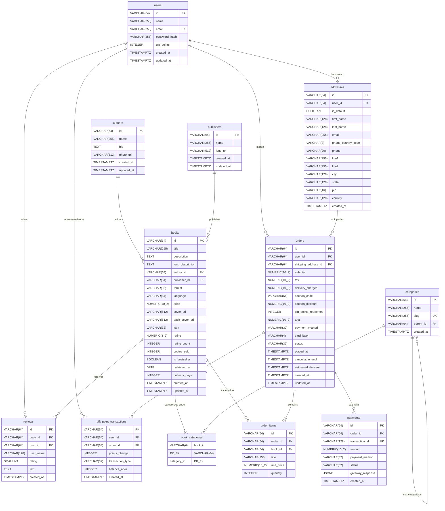

# Book Worm — PostgreSQL Data Model Specification

This document details the relational database architecture supporting the Book Worm e-bookstore backend. The design provides strong referential integrity, domain constraint validation, and auditability for customer orders, catalogue relations, gift point transactions, and payment logs.

---

## 1. Entity-Relationship Diagram



---

## 2. Table Specifications

### 2.1 `authors`
Stores biographical information and metadata for writers.

| Column | Type | Constraints | Description |
| --- | --- | --- | --- |
| `id` | `VARCHAR(64)` | `PRIMARY KEY` | Unique author identifier (e.g. `author-1`) |
| `name` | `VARCHAR(255)` | `NOT NULL` | Author full display name |
| `bio` | `TEXT` | `NOT NULL` | Short biography and background |
| `photo_url` | `VARCHAR(512)` | `NULL` | Optional headshot image URL |
| `created_at` | `TIMESTAMPTZ` | `NOT NULL DEFAULT NOW()` | Record creation timestamp |
| `updated_at` | `TIMESTAMPTZ` | `NOT NULL DEFAULT NOW()` | Last update timestamp |

---

### 2.2 `publishers`
Stores publishing house profiles ("brands").

| Column | Type | Constraints | Description |
| --- | --- | --- | --- |
| `id` | `VARCHAR(64)` | `PRIMARY KEY` | Unique publisher identifier (e.g. `pub-1`) |
| `name` | `VARCHAR(255)` | `NOT NULL UNIQUE` | Publisher company name |
| `logo_url` | `VARCHAR(512)` | `NULL` | Optional publisher logo URL |
| `created_at` | `TIMESTAMPTZ` | `NOT NULL DEFAULT NOW()` | Record creation timestamp |
| `updated_at` | `TIMESTAMPTZ` | `NOT NULL DEFAULT NOW()` | Last update timestamp |

---

### 2.3 `categories`
Hierarchical taxonomy for book classification (supports parent and subcategories).

| Column | Type | Constraints | Description |
| --- | --- | --- | --- |
| `id` | `VARCHAR(64)` | `PRIMARY KEY` | Unique category identifier (e.g. `cat-fiction`) |
| `name` | `VARCHAR(255)` | `NOT NULL` | Human-readable category title |
| `slug` | `VARCHAR(255)` | `NOT NULL UNIQUE` | URL-safe slug (e.g. `self-help`) |
| `parent_id` | `VARCHAR(64)` | `NULL REFERENCES categories(id) ON DELETE SET NULL` | Parent category reference for hierarchy |
| `created_at` | `TIMESTAMPTZ` | `NOT NULL DEFAULT NOW()` | Record creation timestamp |

---

### 2.4 `books`
Primary book catalogue entity containing formats, pricing, and performance metrics.

| Column | Type | Constraints | Description |
| --- | --- | --- | --- |
| `id` | `VARCHAR(64)` | `PRIMARY KEY` | Unique book slug identifier |
| `title` | `VARCHAR(255)` | `NOT NULL` | Title of the publication |
| `description` | `TEXT` | `NOT NULL` | Summary / card description |
| `long_description`| `TEXT` | `NULL` | Extended synopsis for product detail page |
| `author_id` | `VARCHAR(64)` | `NOT NULL REFERENCES authors(id) ON DELETE RESTRICT` | Foreign key to author |
| `publisher_id` | `VARCHAR(64)` | `NOT NULL REFERENCES publishers(id) ON DELETE RESTRICT` | Foreign key to publisher |
| `format` | `VARCHAR(32)` | `NOT NULL CHECK (format IN ('Paperback', 'Hardcover', 'eBook'))` | Publication format |
| `language` | `VARCHAR(64)` | `NOT NULL DEFAULT 'English'` | Primary language |
| `price` | `NUMERIC(10, 2)`| `NOT NULL CHECK (price >= 0)` | Price in INR |
| `cover_url` | `VARCHAR(512)` | `NULL` | Front cover artwork path or URI |
| `back_cover_url`| `VARCHAR(512)` | `NULL` | Back cover artwork path or URI |
| `isbn` | `VARCHAR(32)` | `NULL` | ISBN-10 or ISBN-13 identifier |
| `rating` | `NUMERIC(3, 2)`| `NOT NULL DEFAULT 0.0 CHECK (rating >= 0 AND rating <= 5)` | Aggregate average rating |
| `rating_count` | `INTEGER` | `NOT NULL DEFAULT 0 CHECK (rating_count >= 0)` | Total number of submitted reviews |
| `copies_sold` | `INTEGER` | `NOT NULL DEFAULT 0 CHECK (copies_sold >= 0)` | Cumulative sales count |
| `is_bestseller`| `BOOLEAN` | `NOT NULL DEFAULT FALSE` | Flag for bestseller ribbon & shelf sorting |
| `published_at` | `DATE` | `NOT NULL` | Publication date |
| `delivery_days`| `INTEGER` | `NULL CHECK (delivery_days >= 0)` | Estimated delivery duration (null for eBooks) |
| `created_at` | `TIMESTAMPTZ` | `NOT NULL DEFAULT NOW()` | Record creation timestamp |
| `updated_at` | `TIMESTAMPTZ` | `NOT NULL DEFAULT NOW()` | Last update timestamp |

---

### 2.5 `book_categories`
Many-to-many junction table mapping books to one or multiple categories.

| Column | Type | Constraints | Description |
| --- | --- | --- | --- |
| `book_id` | `VARCHAR(64)` | `NOT NULL REFERENCES books(id) ON DELETE CASCADE` | Composite primary key part 1 |
| `category_id` | `VARCHAR(64)` | `NOT NULL REFERENCES categories(id) ON DELETE CASCADE` | Composite primary key part 2 |

*Primary Key:* `(book_id, category_id)`

---

### 2.6 `users`
Registered customer accounts holding gift point balances and credential hashes.

| Column | Type | Constraints | Description |
| --- | --- | --- | --- |
| `id` | `VARCHAR(64)` | `PRIMARY KEY` | User identifier (e.g. `user-demo`) |
| `name` | `VARCHAR(255)` | `NOT NULL` | Full customer name |
| `email` | `VARCHAR(255)` | `NOT NULL UNIQUE` | Customer login email |
| `password_hash` | `VARCHAR(255)` | `NOT NULL` | Secure salted password hash (e.g. Argon2id / bcrypt) |
| `gift_points` | `INTEGER` | `NOT NULL DEFAULT 0 CHECK (gift_points >= 0)` | Current reward points balance (1 pt = ₹1) |
| `created_at` | `TIMESTAMPTZ` | `NOT NULL DEFAULT NOW()` | Account creation date |
| `updated_at` | `TIMESTAMPTZ` | `NOT NULL DEFAULT NOW()` | Account update date |

---

### 2.7 `addresses`
Shipping addresses for orders and user address book entries.

| Column | Type | Constraints | Description |
| --- | --- | --- | --- |
| `id` | `VARCHAR(64)` | `PRIMARY KEY` | Address identifier |
| `user_id` | `VARCHAR(64)` | `NULL REFERENCES users(id) ON DELETE CASCADE` | Associated user (null for guest checkout) |
| `is_default` | `BOOLEAN` | `NOT NULL DEFAULT FALSE` | Default saved address flag for user profile |
| `first_name` | `VARCHAR(128)` | `NOT NULL` | Recipient first name |
| `last_name` | `VARCHAR(128)` | `NOT NULL` | Recipient last name |
| `email` | `VARCHAR(255)` | `NOT NULL` | Shipping notification contact email |
| `phone_country_code`| `VARCHAR(8)` | `NOT NULL DEFAULT '+91'` | Country dial code |
| `phone` | `VARCHAR(20)` | `NOT NULL` | Contact telephone number |
| `line1` | `VARCHAR(255)` | `NOT NULL` | Street address line 1 |
| `line2` | `VARCHAR(255)` | `NULL` | Suite / apartment line 2 |
| `city` | `VARCHAR(128)` | `NOT NULL` | City / municipality |
| `state` | `VARCHAR(128)` | `NOT NULL` | State / Province |
| `pin` | `VARCHAR(16)` | `NOT NULL` | Postal PIN code |
| `country` | `VARCHAR(128)` | `NOT NULL DEFAULT 'India'` | Destination country |
| `created_at` | `TIMESTAMPTZ` | `NOT NULL DEFAULT NOW()` | Address entry timestamp |

---

### 2.8 `reviews`
Customer ratings and reviews left on book detail pages.

| Column | Type | Constraints | Description |
| --- | --- | --- | --- |
| `id` | `VARCHAR(64)` | `PRIMARY KEY` | Review identifier |
| `book_id` | `VARCHAR(64)` | `NOT NULL REFERENCES books(id) ON DELETE CASCADE` | Reviewed book reference |
| `user_id` | `VARCHAR(64)` | `NULL REFERENCES users(id) ON DELETE SET NULL` | Reviewer user ID (null for guest reviews) |
| `user_name` | `VARCHAR(128)` | `NOT NULL` | Public reviewer display name |
| `rating` | `SMALLINT` | `NOT NULL CHECK (rating >= 1 AND rating <= 5)` | Star rating (1 to 5) |
| `text` | `TEXT` | `NOT NULL` | Written review content |
| `created_at` | `TIMESTAMPTZ` | `NOT NULL DEFAULT NOW()` | Submission timestamp |

---

### 2.9 `orders`
Master order record tracking amounts, taxes, discounts, delivery dates, and cancellation deadlines.

| Column | Type | Constraints | Description |
| --- | --- | --- | --- |
| `id` | `VARCHAR(64)` | `PRIMARY KEY` | Order identifier (e.g. `ord-1710000000000-a1b2`) |
| `user_id` | `VARCHAR(64)` | `NULL REFERENCES users(id) ON DELETE SET NULL` | Buyer account reference (null for guests) |
| `shipping_address_id` | `VARCHAR(64)` | `NOT NULL REFERENCES addresses(id) ON DELETE RESTRICT` | Shipping destination address reference |
| `subtotal` | `NUMERIC(10, 2)`| `NOT NULL CHECK (subtotal >= 0)` | Item subtotal before tax and discounts |
| `tax` | `NUMERIC(10, 2)`| `NOT NULL CHECK (tax >= 0)` | Standard 12% sales tax calculation |
| `delivery_charges` | `NUMERIC(10, 2)`| `NOT NULL DEFAULT 0 CHECK (delivery_charges >= 0)` | Shipping freight charge |
| `coupon_code` | `VARCHAR(64)` | `NULL` | Applied coupon voucher (e.g. `BOOKWORM100`) |
| `coupon_discount` | `NUMERIC(10, 2)`| `NOT NULL DEFAULT 0 CHECK (coupon_discount >= 0)` | Coupon deduction amount |
| `gift_points_redeemed`| `INTEGER` | `NOT NULL DEFAULT 0 CHECK (gift_points_redeemed >= 0)` | Points applied (₹1 / point) |
| `total` | `NUMERIC(10, 2)`| `NOT NULL CHECK (total >= 0)` | Net payable order amount |
| `payment_method` | `VARCHAR(32)` | `NOT NULL CHECK (payment_method IN ('credit-card', 'debit-card', 'upi', 'wallet'))` | Payment method employed |
| `card_last4` | `VARCHAR(4)` | `NULL` | Truncated last 4 digits for card payments |
| `status` | `VARCHAR(32)` | `NOT NULL DEFAULT 'confirmed' CHECK (status IN ('confirmed', 'cancelled', 'delivered'))` | Order lifecycle status |
| `placed_at` | `TIMESTAMPTZ` | `NOT NULL DEFAULT NOW()` | Order placement timestamp |
| `cancellable_until` | `TIMESTAMPTZ` | `NOT NULL` | Cancellation window cutoff (`placed_at + 48h`) |
| `estimated_delivery` | `TIMESTAMPTZ` | `NULL` | Expected fulfillment arrival date |
| `created_at` | `TIMESTAMPTZ` | `NOT NULL DEFAULT NOW()` | Order creation timestamp |
| `updated_at` | `TIMESTAMPTZ` | `NOT NULL DEFAULT NOW()` | Status update timestamp |

---

### 2.10 `order_items`
Individual line items purchased within an order.

| Column | Type | Constraints | Description |
| --- | --- | --- | --- |
| `id` | `VARCHAR(64)` | `PRIMARY KEY` | Line item identifier |
| `order_id` | `VARCHAR(64)` | `NOT NULL REFERENCES orders(id) ON DELETE CASCADE` | Parent order reference |
| `book_id` | `VARCHAR(64)` | `NOT NULL REFERENCES books(id) ON DELETE RESTRICT` | Referenced book |
| `title` | `VARCHAR(255)` | `NOT NULL` | Historical snapshot of book title |
| `unit_price` | `NUMERIC(10, 2)`| `NOT NULL CHECK (unit_price >= 0)` | Historical snapshot of item unit price |
| `quantity` | `INTEGER` | `NOT NULL CHECK (quantity > 0)` | Purchased quantity |

---

### 2.11 `payments`
Audit log of payment gateway transaction attempts and settlements.

| Column | Type | Constraints | Description |
| --- | --- | --- | --- |
| `id` | `VARCHAR(64)` | `PRIMARY KEY` | Internal payment transaction record ID |
| `order_id` | `VARCHAR(64)` | `NOT NULL REFERENCES orders(id) ON DELETE CASCADE` | Order associated with payment |
| `transaction_id` | `VARCHAR(128)` | `NOT NULL UNIQUE` | Gateway external reference ID |
| `amount` | `NUMERIC(10, 2)`| `NOT NULL CHECK (amount >= 0)` | Transaction processed amount in INR |
| `payment_method` | `VARCHAR(32)` | `NOT NULL CHECK (payment_method IN ('credit-card', 'debit-card', 'upi', 'wallet'))` | Payment channel |
| `status` | `VARCHAR(32)` | `NOT NULL CHECK (status IN ('pending', 'successful', 'failed', 'refunded'))` | Gateway transaction outcome |
| `gateway_response` | `JSONB` | `NULL` | Full parsed webhook / gateway payload |
| `created_at` | `TIMESTAMPTZ` | `NOT NULL DEFAULT NOW()` | Transaction log timestamp |

---

### 2.12 `gift_point_transactions`
Ledger of point debits (redemptions on order checkout) and credits (refunds on order cancellation or loyalty rewards).

| Column | Type | Constraints | Description |
| --- | --- | --- | --- |
| `id` | `VARCHAR(64)` | `PRIMARY KEY` | Ledger entry identifier |
| `user_id` | `VARCHAR(64)` | `NOT NULL REFERENCES users(id) ON DELETE CASCADE` | Associated customer account |
| `order_id` | `VARCHAR(64)` | `NULL REFERENCES orders(id) ON DELETE SET NULL` | Linked order for redemptions/refunds |
| `points_change` | `INTEGER` | `NOT NULL` | Signed points change (negative for debit, positive for credit) |
| `transaction_type` | `VARCHAR(32)` | `NOT NULL CHECK (transaction_type IN ('redemption', 'refund', 'reward_bonus', 'adjustment'))` | Transaction category |
| `balance_after` | `INTEGER` | `NOT NULL CHECK (balance_after >= 0)` | Snapshot of user balance post-transaction |
| `created_at` | `TIMESTAMPTZ` | `NOT NULL DEFAULT NOW()` | Ledger timestamp |

---

## 3. Database Indexes

Recommended performance indexes for query optimization:

```sql
-- Books search, filtering and recommendation queries
CREATE INDEX idx_books_author_id ON books(author_id);
CREATE INDEX idx_books_publisher_id ON books(publisher_id);
CREATE INDEX idx_books_price ON books(price);
CREATE INDEX idx_books_rating ON books(rating DESC);
CREATE INDEX idx_books_published_at ON books(published_at DESC);
CREATE INDEX idx_book_categories_category ON book_categories(category_id, book_id);

-- User orders and history
CREATE INDEX idx_orders_user_id ON orders(user_id);
CREATE INDEX idx_orders_placed_at ON orders(placed_at DESC);
CREATE INDEX idx_order_items_order_id ON order_items(order_id);
CREATE INDEX idx_order_items_book_id ON order_items(book_id);

-- Reviews
CREATE INDEX idx_reviews_book_id ON reviews(book_id, created_at DESC);

-- Gift points ledger
CREATE INDEX idx_gift_point_tx_user ON gift_point_transactions(user_id, created_at DESC);
```
